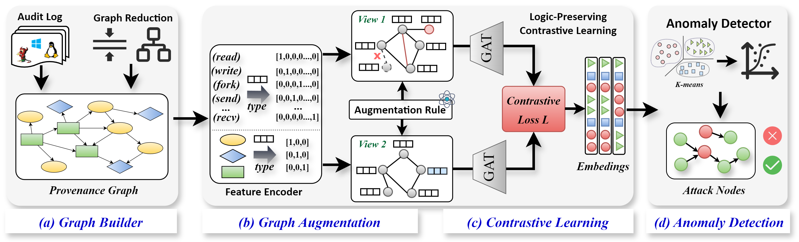

# ProvGuard

ProvGuard is the official implementation of **ProvGuard: Logic-Aware Multi-View Contrastive Learning for Robust and Efficient Host Threat Detection (WWW2026)**.  
This project provides the core code and resources for reproducing the experiments and results reported in the paper.



## Introduction
ProvGuard introduces a **logic-aware multi-view contrastive learning framework** for provenance-based intrusion detection.  
The system first encodes raw provenance graphs and then generates **logic-aware augmented views** to simulate potential adversarial attacks.  
A **Graph Attention Network (GAT)** encoder and a **contrastive learning module** are used to learn invariant and semantically rich graph representations, enabling accurate and robust anomaly detection even under sophisticated manipulation attempts.

## Repository Structure
```text
ProvGuard/
Utils/      - Helper functions and essential components
data/       - Datasets and metadata used in the experiments
eval/       - Evaluation scripts for benchmarking detection performance
model/      - Model definitions (GNN encoder, contrastive modules, etc.)
train/      - Training scripts for contrastive learning and detector
README.md   - Project description
